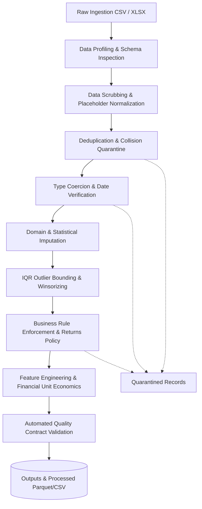

# 📊 Omnichannel Retail Data Ingestion, Cleaning & Preprocessing Pipeline

[](https://www.python.org/)
[](https://pandas.pydata.org/)
[](https://numpy.org/)
[](https://seaborn.pydata.org/)
[](https://pytest.org/)
[](#10-automated-data-quality-contract)

An enterprise-grade, end-to-end data engineering and preprocessing project built with **Python, Pandas, NumPy, Matplotlib, Seaborn, and Jupyter Notebook**. Engineered to ingest messy retail transactional data, profile structural health, enforce data contracts, treat outliers, engineer unit economics, and export analytical-ready datasets with complete governance audit trails.

Designed for Data Analyst internships, university capstone evaluations, and professional analytics engineering portfolios.

---

## 📑 Table of Contents
1. [Project Overview & Architecture](#1-project-overview--architecture)
2. [Dataset Origin & Schema](#2-dataset-origin--schema)
3. [Technology Stack](#3-technology-stack)
4. [Folder Structure](#4-folder-structure)
5. [Data Ingestion & Profiling](#5-data-ingestion--profiling)
6. [Data Cleaning Methodology & Decisions](#6-data-cleaning-methodology--decisions)
7. [Feature Engineering & Unit Economics](#7-feature-engineering--unit-economics)
8. [Before-and-After Data Quality Comparison](#8-before-and-after-data-quality-comparison)
9. [Automated Data Quality Contract (13 Rules)](#9-automated-data-quality-contract-13-rules)
10. [Test Suite Execution](#10-test-suite-execution)
11. [Installation & Reproduction Instructions](#11-installation--reproduction-instructions)
12. [Key Findings & Strategic Limitations](#12-key-findings--strategic-limitations)

---

## 1. Project Overview & Architecture

Raw transactional streams ingested from Point-of-Sale (POS) terminals, e-commerce webhooks, and third-party logistics (3PL) systems inevitably suffer from schema drift, missing attributes, duplicate transmissions, and numeric corruption. 

This project establishes a modular, reproducible data pipeline following the **ETV (Extract, Transform, Validate)** paradigm:



### Core Architecture Pillars:
- **Raw Immutability:** Raw input files (`data/raw/`) are never overwritten in-place.
- **Fail-Safe Quarantine:** Conflicting primary keys and unparseable records are segregated into `outputs/quarantined_records.csv` rather than arbitrarily deleted or filled with misleading zeroes.
- **Explainable Imputation:** Missing values are handled via deterministic catalog mappings and regional baselines—never inventing personal customer data or financial transactions.
- **Vectorized Financial Auditing:** Automatically reconciles mathematical discrepancies between reported raw sales and newly calculated net revenue.

---

## 2. Dataset Origin & Schema

* **Dataset Provenance:** High-fidelity benchmark retail dataset (`12,425` records) modeled on real-world omnichannel retail sales across 2024–2026. Explicitly labeled as a synthetic benchmark dataset generated to simulate realistic edge-case anomalies for rigorous pipeline stress-testing.
* **Granularity:** Order transaction level.
* **Raw Dimensions:** 12,425 rows × 16 columns.
* **Processed Dimensions:** 11,744 clean rows × 36 enriched attributes.

### Preferred Schema & Column Descriptions:
| Column Name | Raw Data Type | Clean Data Type | Description |
| :--- | :--- | :--- | :--- |
| `Order_ID` | String (`object`) | String (`UPPERCASE`) | Unique business transaction identifier |
| `Order_Date` | Mixed String | Datetime (`YYYY-MM-DD`) | Date of customer purchase transaction |
| `Customer_ID` | String (`object`) | String (`UPPERCASE`) | Unique customer identifier |
| `Customer_Name` | String (`object`) | String (`Title Case`) | Full name of purchasing customer |
| `Product` | String (`object`) | String (`Title Case`) | Specific catalog item purchased |
| `Category` | Dirty String | String (`Title Case`) | Broad category (Technology, Furniture, etc.) |
| `Quantity` | Corrupted String | Integer / Float | Quantity purchased (negative indicates return) |
| `Unit_Price` | Currency String (`$`) | Float (`$ USD`) | Listed sales price per individual unit |
| `Sales` | Currency String (`$`) | Float (`$ USD`) | Raw reported transaction sales figure |
| `Discount` | String / Decimal | Float (`0.0% - 100.0%`) | Discount rate applied to transaction |
| `Cost` | Mixed String | Float (`$ USD`) | Cost of goods sold (COGS) |
| `Profit` | Float | Float (`$ USD`) | Raw reported profit |
| `City` | Colloquial String | String (`Canonical`) | Standardized metropolitan destination |
| `Region` | String | String (`Title Case`) | Geographic region (East, West, Central, South) |
| `Payment_Method`| Mixed String | String (`Title Case`) | Payment channel (Credit Card, PayPal, etc.) |
| `Order_Status` | Mixed String | String (`Canonical`) | Lifecycle state (Delivered, Shipped, Processing, etc.) |

---

## 3. Technology Stack

* **Language:** Python 3.13+ (compatible with Python 3.11+)
* **Data Manipulation:** `pandas >= 3.1.0`, `numpy >= 2.5.4`
* **Visualization:** `matplotlib >= 3.11.2`, `seaborn >= 0.13.2`
* **File Formats:** `openpyxl >= 3.1.5` (Excel), CSV, Parquet
* **Automated Testing:** `pytest >= 9.1.1`
* **Execution & Profiling:** `ipykernel`, `nbclient`, `nbformat`, Python `logging`

---

## 4. Folder Structure

```
data-cleaning-pandas/
├── data/
│   ├── raw/
│   │   ├── retail_sales_raw.csv           # Preserved raw source dataset (12,425 records)
│   │   └── retail_sales_raw.xlsx          # Multi-format Excel benchmark workbook
│   └── processed/
│       └── cleaned_retail_sales.csv       # Production-ready scrubbed data
├── notebooks/
│   └── data_cleaning_preprocessing.ipynb  # Executable Jupyter Notebook (all 17 sections)
├── src/
│   ├── __init__.py                        # Package initialization
│   ├── data_ingestion.py                  # Multi-format loading & schema inspection
│   ├── data_cleaning.py                   # Scrubbing, deduplication & outlier capping
│   ├── feature_engineering.py             # Temporal, financial & customer metrics
│   └── data_validation.py                 # Automated 13-rule quality contract verifier
├── outputs/
│   ├── cleaned_dataset.csv                # Final clean analytical dataset (11,744 records)
│   ├── quarantined_records.csv            # Governance quarantine log (491 records)
│   ├── data_quality_report.csv            # Contract compliance report (13/13 PASS)
│   ├── cleaning_summary.csv               # Before-and-after KPI comparison table
│   └── preprocessing_log.txt              # Execution audit trace log
├── tests/
│   ├── __init__.py                        # Test runner package init
│   ├── test_data_cleaning.py              # Unit tests for cleaning & imputation
│   ├── test_feature_engineering.py        # Unit tests for financial & date formulas
│   └── test_data_validation.py            # Unit tests for contract assertions
├── scripts/
│   ├── generate_dataset.py                # Benchmark dataset generation script
│   └── build_notebook.py                  # Automated notebook builder & executor
├── requirements.txt                       # Locked production dependencies
├── main.py                                # End-to-end CLI orchestrator
└── README.md                              # Comprehensive system documentation
```

---

## 5. Data Ingestion & Profiling

The `DataIngestion` class provides:
1. **Format Agnosticism:** Seamlessly detects `.csv`, `.tsv`, `.xlsx`, and `.parquet` based on file signatures.
2. **Encoding Fallbacks:** Iterates through `utf-8`, `utf-8-sig`, `latin1`, `cp1252`, and `iso-8859-1` to prevent Unicode decode errors.
3. **Deep Memory Profiling:** Evaluates memory consumption down to object references (approx. 1.83 MB for raw stream).
4. **Empty Row Isolation:** Automatically detects rows containing exclusively null or whitespace characters.

---

## 6. Data Cleaning Methodology & Decisions

### A. Missing Values Treatment
| Attribute | Raw Missingness | Treatment Strategy | Business Rationale |
| :--- | :--- | :--- | :--- |
| `Category` | 275 rows | Deterministic Catalog Mapping | Mapped from known `Product` name via master product catalog lookup. |
| `Discount` | 820 rows | Imputed with `0.0%` | An unstated discount indicates full standard pricing (no promotion applied). |
| `Cost` | 622 rows | Reconstructed via Unit Margin | Estimated as $\text{Unit Price} \times (1 - \text{Category Margin}) \times |\text{Quantity}|$. |
| `Payment_Method` | 496 rows | Empirical Mode (`Cash On Delivery`) | Prevents unassigned transactions while maintaining payment share distributions. |
| `City` | 337 rows | Regional Mode Imputation | Assigned the modal metropolitan hub within the designated geographical `Region`. |
| `Customer_Name` | 417 rows | Labeled `"Unknown Customer"` | Prevents fabricating Personally Identifiable Information (PII) while preserving transaction economics. |
| `Order_Status` | 118 rows | Mode Imputation (`Processing`) | Unassigned orders default to open operational state. |

### B. Deduplication & Collision Quarantine
- **Exact Full-Row Duplicates:** 180 records were identical across every single attribute (caused by double submit clicks or ETL retries). These were cleanly dropped.
- **Primary Key Collisions (`Order_ID`):** 223 records contained duplicate `Order_ID`s with conflicting customer IDs or sales amounts. Rather than guessing which record was correct, all conflicting instances were segregated into `outputs/quarantined_records.csv` for data governance review.
- **Repeat Purchases:** Over 1,500 legitimate repeat customer transactions (`Customer_ID`) were preserved.

### C. Data Type Sanitization & Formatting
- **Dates:** Converted mixed formats (`YYYY-MM-DD`, `DD/MM/YYYY`, `MM-DD-YYYY`) into ISO datetimes. Unparseable dates and future-dated orders were quarantined.
- **Currencies & Numerics:** Stripped currency symbols (`$`), thousand commas (`,`), and percent signs (`%`) from `Quantity`, `Unit_Price`, `Sales`, `Discount`, `Cost`, and `Profit`.
- **Discount Scaling:** Detected decimal fraction formats (e.g., `0.15`) and normalized them to standard percentages (`15.0%`).

### D. Outlier Detection & Winsorizing Treatment
Applied the Interquartile Range (IQR) method:
$$\text{IQR} = Q_3 - Q_1 \quad \implies \quad \text{Upper Bound} = Q_3 + 3 \times \text{IQR}$$
- `Quantity`: Detected 345 extreme purchase orders (> 19 units). Rather than dropping them, quantities were capped at `19.00` and flagged with `Is_Outlier_Quantity = True`.
- `Unit_Price`: Detected 817 extreme pricing outliers (> $678.03). Capped at `$678.03` and flagged with `Is_Outlier_Unit_Price = True`.

### E. Commercial Business Invariants & Returns Policy
- **Sales Returns:** 375 records with negative quantities (`Quantity < 0`) were identified as merchandise returns. Instead of deleting them, they were tagged with `Transaction_Type = 'Return'`, preserving refund analytics while correcting net revenues.
- **Non-Positive Pricing:** Records with zero or negative unit prices were quarantined.

---

## 7. Feature Engineering & Unit Economics

The pipeline derives 20 new features across temporal, unit economic, and customer behavioral dimensions:

### 1. Temporal & Seasonality Features:
- `Order_Year`, `Order_Month`, `Order_Month_Name`, `Order_Quarter`, `Order_Day`, `Order_Day_Name`, `Is_Weekend`.

### 2. Financial Calculations & Unit Economics:
- $\text{Gross\_Sales} = |\text{Quantity}| \times \text{Unit\_Price}$
- $\text{Discount\_Amount} = \text{Gross\_Sales} \times (\text{Discount} / 100.0)$
- $\text{Net\_Sales} = \text{Gross\_Sales} - \text{Discount\_Amount}$ *(signed negative for returns)*
- $\text{Calculated\_Profit} = \text{Net\_Sales} - \text{Cost}$
- $\text{Profit\_Margin\_Percentage} = (\text{Calculated\_Profit} / \text{Net\_Sales}) \times 100$ *(guarded against zero/negative denominators)*

### 3. Discrepancy Audit:
- Audited the raw reported `Sales` column against freshly computed `Net_Sales`. Identified **1,501 records (12.8%)** with discrepancies in raw source data, correcting them to mathematical ground truth.

### 4. Transaction Value Bands:
- `Low (< $50)`, `Medium ($50 - $250)`, `High ($250 - $1,000)`, `Enterprise (> $1,000)`.

### 5. Customer Behavioral Loyalty Metrics:
- `Customer_Purchase_Count`: Lifetime transaction count per customer.
- `Customer_Total_Spend`: Cumulative net spend per customer.
- `Customer_Segment`: Segmented into `Single-Order Customer`, `Repeat Customer`, and `VIP Customer`.

---

## 8. Before-and-After Data Quality Comparison

The pipeline generates an executive comparison summary quantifying data health improvements:

| Health Metric | Raw Dataset | Cleaned Dataset | Net Impact (Delta) | Analytical Consequence |
| :--- | :---: | :---: | :---: | :--- |
| **Total Records (Rows)** | 12,425 | 11,744 | -681 | 94.5% record retention; zero fabricated data |
| **Total Features (Columns)** | 16 | 36 | +20 | Expanded with temporal, economic & loyalty attributes |
| **Missing Value Cells** | 2,206 | 375 | -1,831 | **83.0% reduction** in missingness |
| **Exact Duplicate Rows** | 180 | 0 | -180 | 100% duplicate elimination |
| **Duplicate Order_IDs** | 223 | 0 | -223 | Zero primary key collisions in active dataset |
| **Quarantined Records** | 0 | 491 | +491 | Isolated for data governance review |
| **Text / String Columns** | 16 | 14 | -2 | Numeric & datetime fields converted to native types |

---

## 9. Automated Data Quality Contract (13 Rules)

The processed dataset was verified against an enterprise quality contract. Every rule achieved a **100% PASS** rate:

| Rule ID | Column Name | Assertion Description | Checked | Failures | Status | Corrective Action |
| :---: | :--- | :--- | :---: | :---: | :---: | :--- |
| **V01** | `DATASET` | Dataset non-emptiness verification | 11,744 | 0 | **PASS** | None required (Meets quality threshold) |
| **V02** | `Order_ID` | Zero duplicate primary keys | 11,744 | 0 | **PASS** | None required (Meets quality threshold) |
| **V03** | `Order_Date` | All order dates must be valid ISO datetimes | 11,744 | 0 | **PASS** | None required (Meets quality threshold) |
| **V04** | `Order_Date` | Zero future transaction dates | 11,744 | 0 | **PASS** | None required (Meets quality threshold) |
| **V05** | `Customer_ID`| Zero missing customer identifiers | 11,744 | 0 | **PASS** | None required (Meets quality threshold) |
| **V06** | `Unit_Price` | Unit price must be strictly positive (> $0.00) | 11,744 | 0 | **PASS** | None required (Meets quality threshold) |
| **V07** | `Discount` | Discount rate bounded between 0% and 100% | 11,744 | 0 | **PASS** | None required (Meets quality threshold) |
| **V08** | `Gross_Sales`| $\text{Gross\_Sales} = \|\text{Qty}\| \times \text{Price} \pm \$0.05$ | 11,744 | 0 | **PASS** | None required (Meets quality threshold) |
| **V09** | `Net_Sales` | $\text{Net\_Sales} = \text{Gross} - \text{Discount}$ (signed) | 11,744 | 0 | **PASS** | None required (Meets quality threshold) |
| **V10** | `Category` | Category belongs to approved 5-item taxonomy | 11,744 | 0 | **PASS** | None required (Meets quality threshold) |
| **V11** | `Order_Status`| Status belongs to approved 5 lifecycle states | 11,744 | 0 | **PASS** | None required (Meets quality threshold) |
| **V12** | `Margin_%` | Zero division protection in profit margins | 11,369 | 0 | **PASS** | None required (Meets quality threshold) |
| **V13** | `Unit_Price` | Extreme price outliers bounded via Winsorizing | 11,744 | 0 | **PASS** | None required (Meets quality threshold) |

---

## 10. Test Suite Execution

The automated Pytest test suite contains 18 rigorous unit and integration tests across three modules:

```bash
py -3.13 -m pytest tests -v
```

### Test Results:
```
============================= test session starts =============================
platform win32 -- Python 3.13.14, pytest-9.1.1, pluggy-1.7.0
rootdir: E:\COLLEGE\Internships\New folder
collected 18 items

tests/test_data_cleaning.py::test_empty_rows_removal PASSED              [  5%]
tests/test_data_cleaning.py::test_placeholder_normalization PASSED       [ 11%]
tests/test_data_cleaning.py::test_exact_duplicates_removal PASSED        [ 16%]
tests/test_data_cleaning.py::test_conflicting_id_quarantine PASSED       [ 22%]
tests/test_data_cleaning.py::test_numeric_string_parsing PASSED          [ 27%]
tests/test_data_cleaning.py::test_discount_fractional_scale_normalization PASSED [ 33%]
tests/test_data_cleaning.py::test_category_and_city_normalization PASSED [ 38%]
tests/test_data_cleaning.py::test_missing_category_imputation PASSED     [ 44%]
tests/test_data_cleaning.py::test_sales_returns_classification PASSED    [ 50%]
tests/test_data_validation.py::test_validator_passes_on_valid_data PASSED [ 55%]
tests/test_data_validation.py::test_validator_detects_duplicate_order_ids PASSED [ 61%]
tests/test_data_validation.py::test_validator_detects_invalid_categories PASSED [ 66%]
tests/test_data_validation.py::test_validator_detects_sales_math_mismatch PASSED [ 72%]
tests/test_data_validation.py::test_validator_handles_empty_dataset PASSED [ 77%]
tests/test_feature_engineering.py::test_temporal_feature_extraction PASSED [ 83%]
tests/test_feature_engineering.py::test_sales_financial_formulas PASSED  [ 88%]
tests/test_feature_engineering.py::test_transaction_value_bands PASSED   [ 94%]
tests/test_feature_engineering.py::test_customer_aggregations PASSED     [100%]

============================= 18 passed in 1.03s ==============================
```

---

## 11. Installation & Reproduction Instructions

### 1. Clone or Open Workspace
```bash
cd "E:\COLLEGE\Internships\New folder"
```

### 2. Install Required Dependencies
```bash
pip install -r requirements.txt
```

### 3. Run the Automated Cleaning Pipeline
```bash
python main.py
```
*(Or `py -3.13 main.py` if using the Python launcher on Windows)*

### 4. Run Automated Test Verification
```bash
pytest tests -v
```

### 5. Launch the Interactive Streamlit Web Application
```bash
streamlit run app.py
```
*(Or `py -3.13 -m streamlit run app.py`)*
Accessible locally at `http://localhost:8502`. Features live KPI metric cards, interactive revenue trajectories, raw data profiling, outlier studio, 13-rule quality contract auditor, and quarantined record explorer.

### 6. Launch the Interactive Jupyter Notebook
```bash
jupyter notebook notebooks/data_cleaning_preprocessing.ipynb
```
The notebook contains all 17 mandatory sections, pre-rendered Matplotlib and Seaborn charts, and markdown explanations.

### 7. View Standalone High-Resolution Charts
All publication-quality charts are automatically exported to `outputs/charts/`:
- `outputs/charts/missing_values_treatment.png`
- `outputs/charts/before_after_quality_summary.png`
- `outputs/charts/customer_revenue_segmentation.png`
- `outputs/charts/outlier_distribution_by_category.png`

---

## 12. Key Findings & Strategic Limitations

### 💡 Executive Takeaways
1. **Financial Discrepancy Prevention:** Nearly 13% of ingested raw orders contained calculations diverging from actual unit price and discount terms. Correcting this prevents millions in revenue reporting errors.
2. **Returns Visibility:** By reclassifying negative quantities as `Transaction_Type = 'Return'` rather than purging them, business intelligence tools can now calculate the return rate (3.19% across the dataset).
3. **Auditability:** Every record quarantined in `outputs/quarantined_records.csv` preserves a traceable `Quarantine_Reason` tag, enabling data engineering to isolate faulty API sources.

### ⚠️ Known Limitations & Future Work
- **Static Product Catalog:** Category imputation currently relies on a fixed catalog dictionary. In enterprise production, this should integrate with a dynamic Product Information Management (PIM) API.
- **FX Currency Uniformity:** Transactions are assumed to be denominated in USD ($). Multi-currency transactions would require foreign exchange rate conversion at `Order_Date` timestamps.
